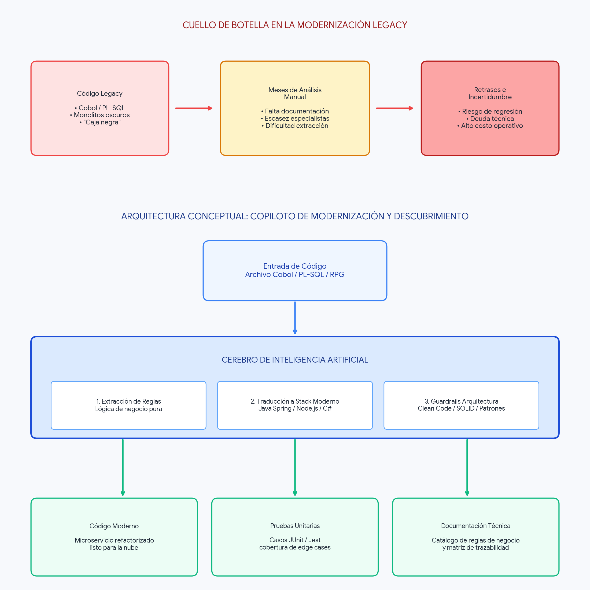

# 02 · Arquitectura de la solución



## Idea central
1. **Cualquier lenguaje de origen → especificación neutral → cualquier lenguaje destino.**
   El copiloto nunca traduce "COBOL a Java" directamente. Primero convierte el código legacy en una
   **especificación independiente del lenguaje** (reglas, modelo de datos, contrato de entrada/salida,
   casos de prueba), el ingeniero la aprueba, y desde ella se genera el código en el lenguaje destino.
   Con N orígenes y M destinos se escriben N + M adaptadores, no N × M traductores.
2. **El LLM razona; parsers, compiladores y pruebas confirman.** Lo determinista no se delega al LLM.

```
 Código legacy ──► [Adaptador de ORIGEN] ──► Especificación neutral ──► HITL ──► [Adaptador de DESTINO] ──► Código moderno
 (COBOL, PL/SQL,     detectar, sanitizar,      (Spec IR, JSON)          aprobar     plantillas, tipos,          (Java, TS, C#,
  RPG, VB6, .NET      parsear, segmentar,       · reglas + trazas                   convenciones, build,          Python, Go…)
  Framework, Java 4…) clasificar, ejecutar      · modelo de dominio                 arnés de pruebas
                                                · contrato I/O (JSON Schema)
                                                · casos golden master
                         │                                                                │
                         └──────────► Verificación neutral: mismos casos JSON ◄───────────┘
                                      comparador campo a campo (tolerancia 0)
```

## Adaptadores ("language packs")
Cada lenguaje se agrega como un paquete en `copilot/languages/<id>/` sin tocar el núcleo.

### Adaptador de origen
| Capacidad | Descripción | Si no existe |
|---|---|---|
| `detect()` | Identifica lenguaje y dialecto (extensión + firmas) | El LLM propone, el usuario confirma |
| `parse()` | AST/estructura: unidades (párrafo, procedimiento, método), llamadas, variables, dependencias, líneas | **Segmentador genérico** por patrones + LLM (confianza menor) |
| `classify()` | Negocio vs. infraestructura (SQL, archivos, UI, red) | Heurísticas genéricas + LLM |
| `type_map` | Tipos del origen → tipos neutrales de la spec | Tabla genérica |
| `runner` | Ejecuta el legacy para obtener el golden master | Ver "niveles de oráculo" |
| `knowledge` | Skill/RAG con la semántica del lenguaje | — |

### Adaptador de destino
| Capacidad | Descripción |
|---|---|
| `scaffold()` | Proyecto base con arquitectura limpia/hexagonal del ecosistema destino |
| `type_map` | Tipos neutrales → tipos destino (decimal exacto, fechas, enteros) |
| `conventions` | Estructura de carpetas, nombres, manejo de errores, reglas de arquitectura |
| `build` / `test` | Comandos para compilar y probar |
| `harness` | Programa que lee `cases.json`, ejecuta el caso de uso y escribe `actual.json` |
| `quality` | Linter/análisis estático del ecosistema + cobertura |

### Tipos neutrales de la especificación
`decimal(p,s, rounding)` · `integer(bits)` · `string(max)` · `date` · `datetime` · `boolean` ·
`enum` · `list<T>` · `record`. Cada adaptador mapea desde/hacia estos tipos. El modo de redondeo
(`HALF_UP`, `HALF_EVEN`, `DOWN`…) es parte del tipo, así nunca se pierde entre lenguajes.

## Packs para el prototipo
| Pack | Rol | Parser | Ejecución del legacy (oráculo) |
|---|---|---|---|
| COBOL | origen | tree-sitter / segmentador propio | GnuCOBOL |
| PL/SQL | origen | segmentador (BEGIN/END, PROCEDURE, CURSOR, EXCEPTION) | Oracle Database Free (contenedor opcional) |
| C#/VB.NET legacy (.NET Framework) | origen | tree-sitter C# | Mono / .NET 8 si compila |
| Java legacy (1.4–6, EJB) | origen | tree-sitter Java | JDK |
| RPG | origen | segmentador genérico | sin ejecución → oráculo nivel C |
| Java 21 + Spring Boot 3 | destino | — | Maven + JUnit |
| TypeScript + Node | destino | — | npm + Jest |
| C# .NET 8 | destino | — | dotnet test (xUnit) |
| Python 3.12 | destino | — | pytest |

Prioridad de construcción: **COBOL → Java** de punta a punta primero, luego un segundo par
(p. ej. **PL/SQL → TypeScript**) para demostrar que la arquitectura es realmente agnóstica.
Los demás packs se agregan con la skill `language-adapters`.

## Niveles de oráculo (honestidad sobre la evidencia)
No todo lenguaje legacy se puede ejecutar en un contenedor. El copiloto declara qué tan fuerte es la
prueba de equivalencia:
| Nivel | Oráculo | Evidencia |
|---|---|---|
| **A** | El legacy se ejecuta (GnuCOBOL, Oracle Free, Mono, JDK) | Máxima: comportamiento real |
| **B** | Pares entrada/salida provistos por el cliente (sintéticos o anonimizados) | Alta |
| **C** | Implementación de referencia independiente generada desde la spec aprobada (N-version) + valores calculados a mano para casos borde | Media; se marca en el reporte |

## Capas
| Capa | Implementación |
|---|---|
| Experiencia | **AgenTCS — Migration Studio** (React + Vite, `ui/`): ruta de migración, selector origen/destino, reglas con evidencia, aprobación HITL, vista lado a lado, pruebas y tablero. Habla con la **API FastAPI** (`copilot/api/`) usando los contratos (ADR-004) |
| Orquestación | **Motor de autocorrección** propio (`copilot/engine/`, ADR-005): extractor → casos → oráculo → bucle generar/compilar/comparar/retroalimentar con memoria de lecciones; el HITL lo gestionan la API y `RunState` |
| Análisis estático | Adaptadores de origen (tree-sitter cuando hay gramática; segmentador genérico si no) + grafo (networkx) + métricas |
| Conocimiento (RAG) | Una skill/carpeta por lenguaje: semántica, tipos, trampas; estándares por destino |
| Verificación | Runners de origen y harness de destino en el contenedor; comparador neutral en Python |
| Gobierno | Enmascaramiento (detect-secrets + regex) antes del LLM; log JSONL de prompts/decisiones; modo replay |

## Agentes
| Agente | Qué hace | Neutral / por lenguaje |
|---|---|---|
| Analista | Corre el adaptador de origen: estructura, dependencias, métricas, riesgo | Usa el pack de origen |
| Extractor de reglas | Produce la spec neutral con trazas a líneas y confianza | Usa la skill del lenguaje origen |
| Arquitecto | Modelo de dominio, contratos (OpenAPI), ADRs | Neutral |
| Desarrollador | Genera código con el pack destino; ciclo compilar → corregir | Usa el pack destino |
| QA/Tester | Casos sintéticos, golden master (runner origen), harness destino, comparación | Comparador neutral |
| Documentador | Matriz de trazabilidad, reportes, informe ejecutivo | Neutral |

## Flujo (8 fases con quality gates)
```
[1 Ingesta]  selección origen/destino, detección, sanitización → gate: 0 secretos, lenguaje confirmado
[2 Análisis] adaptador de origen                               → gate: 100% unidades inventariadas
[3 Spec]     reglas + modelo + contrato I/O + casos            → gate: toda regla con líneas y confianza
[4 HITL] ⏸   aprobar / ajustar / rechazar                      → gate: aprobación explícita
[5 Diseño]   dominio, puertos, OpenAPI, ADRs                   → gate: reglas de arquitectura del destino
[6 Código]   adaptador de destino                               → gate: compila, 0 críticos   ↺
[7 Verif.]   golden master (nivel A/B/C) vs. harness destino    → gate: 100% equivalencia     ↺ vuelve a 6
[8 Paquete]  código, pruebas, docs, reportes, Docker            → gate: un comando
```
